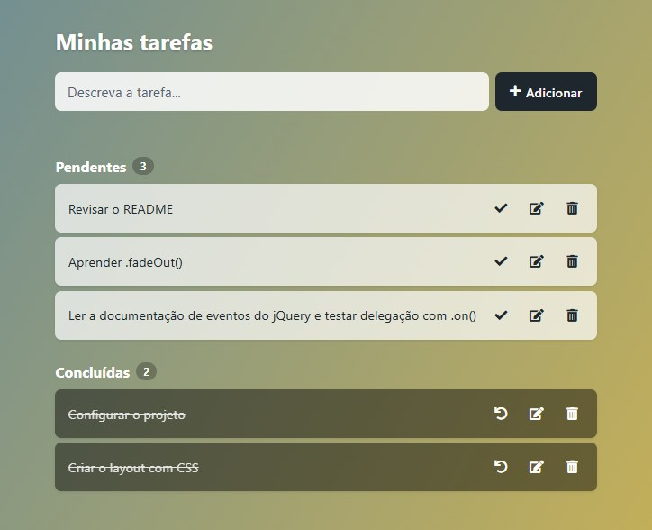

# To Do List com jQuery

**Demo:** https://maksoud.dev/todo-list-jquery/



## Sobre

Lista de tarefas simples criada em 2022 como projeto de estudo de jQuery. A ideia foi praticar seleção e manipulação do DOM, eventos e animações, e salvar estado no navegador com o localStorage.

## Funcionalidades

- Adicionar tarefas com Enter ou pelo botão "Adicionar"
- Concluir tarefas e voltá-las para pendentes
- Editar o texto direto na lista (Enter salva, Esc cancela)
- Remover tarefas
- Contador de pendentes e concluídas, com mensagem quando a lista está vazia
- Tarefas salvas no localStorage (continuam lá ao recarregar a página)
- Funciona pelo teclado e no celular (as ações ficam sempre visíveis)
- O texto digitado é exibido como texto, nunca interpretado como HTML

## Tecnologias

- HTML5 e CSS3
- JavaScript com [jQuery 3.5.1](https://jquery.com/) (arquivo local, sem build)
- Ícones do [Font Awesome 5](https://fontawesome.com/)

## Estrutura de arquivos

```
todo-list-jquery/
├── index.html           # Estrutura da página
├── style.css            # Estilos e layout responsivo
├── script.js            # Lógica da lista (jQuery + localStorage)
├── jquery-3.5.1.min.js  # jQuery
├── favicon.ico
└── screenshot.jpg
```

## Como rodar

Basta abrir o `index.html` no navegador.

Ou sirva a pasta com um servidor local:

```bash
npx serve .
# ou
python -m http.server
```

---

Outros projetos: https://maksoud.dev/projetos/
